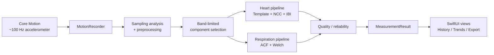
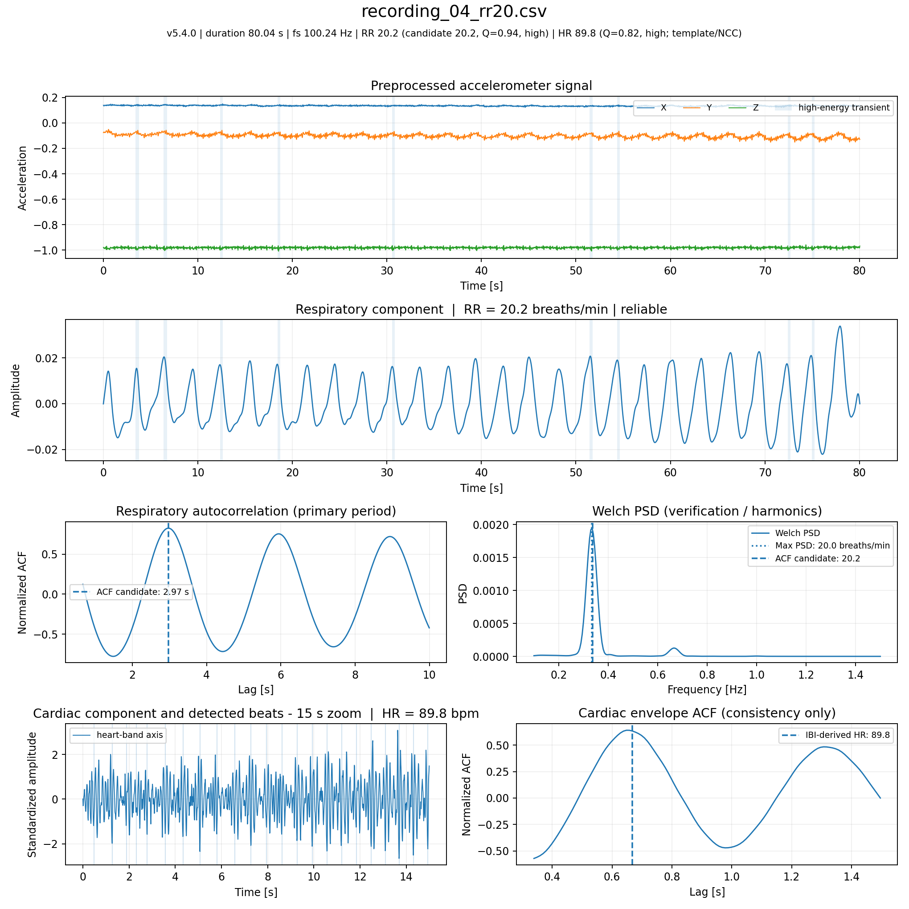

# Pulse

**On-device cardiorespiratory estimation from iPhone accelerometer data.**

Pulse is an iOS research prototype that records subtle chest motion with the iPhone accelerometer and estimates **respiratory rate (RR)** and **heart rate (HR)** using a fully local signal-processing pipeline. The repository includes the Swift implementation used by the app and an independent Python reference implementation used to inspect and reproduce the DSP behaviour.

> **Research / educational software.** Pulse is not a medical device and must not be used for diagnosis, treatment, or clinical decision-making.

<p align="center">
  
</p>

## Why this project

The goal is to extract cardiorespiratory information from a signal that was not designed as a dedicated physiological sensor: the tri-axial accelerometer of an iPhone placed on the chest while the user is lying still.

The project therefore combines:

- native **Swift / SwiftUI** application development;
- **Core Motion** acquisition at approximately 100 Hz;
- sampling diagnostics and resampling when needed;
- zero-phase Butterworth filtering;
- PCA / component selection;
- autocorrelation and Welch spectral analysis for respiration;
- template matching, normalized cross-correlation and inter-beat intervals for heart rate;
- reliability checks designed to withhold ambiguous estimates rather than always returning a number;
- local persistence, history, trends and CSV export;
- a Python reference pipeline for reproducibility and regression testing.

## Architecture



The signal-processing layer is intentionally **Foundation-only** and independent from SwiftUI. `CardiorespiratoryProcessor` orchestrates the DSP stages, while acquisition, persistence and presentation remain separated into services, models, view models and views.

## Repository structure

```text
Pulse/
├── ios/                    # SwiftUI application and Xcode project
│   ├── Pulse.xcodeproj
│   └── Pulse/
│       ├── App/
│       ├── Components/
│       ├── Features/
│       ├── Models/
│       ├── Services/
│       ├── SignalProcessing/
│       └── ViewModels/
├── analysis/               # Independent Python reference implementation
│   ├── data/               # Sample accelerometer recordings
│   ├── tests/              # Regression tests
│   ├── main.py
│   └── requirements.txt
├── docs/
│   ├── presentation.pdf
│   └── sample-analysis.png
└── .github/workflows/      # Automated quality checks
```

## Signal-processing pipeline

### Acquisition and preprocessing

The app records tri-axial acceleration with Core Motion at a requested sampling rate of **100 Hz**. Timestamps are inspected for jitter and anomalous intervals; the signal can be resampled when timing irregularity exceeds the configured threshold. Transients at the beginning and end of the recording are excluded before estimation.

### Respiratory rate

The respiratory branch band-limits the three physical axes, derives an auxiliary principal component, and uses **autocorrelation as the primary period estimator**. A Welch PSD is used as a spectral consistency and harmonic check, while fixed-duration local windows evaluate temporal persistence. Candidates that are inconsistent, insufficiently persistent or plausibly contaminated by cardiac subharmonics can be marked unreliable.

### Heart rate

The cardiac branch filters the physical axes in the cardiomechanical band, automatically selects a beat template, detects repeated morphology with **normalized cross-correlation**, and derives heart rate from valid inter-beat intervals. Envelope autocorrelation and cross-axis agreement act as consistency checks rather than replacing the beat-based estimate.

### Reliability

A key design choice is that an estimate can exist without being published as reliable. The pipeline keeps candidate values and diagnostic information, but the UI can withhold values when the available signal does not provide enough support.

## Example reference result

The included sample recordings use controlled respiratory rates. Running the current Python reference implementation produces the following RR estimates:

| Recording | Controlled RR | Estimated RR |
| --- | ---: | ---: |
| `recording_01_rr08.csv` | 8 | 7.3 |
| `recording_02_rr12.csv` | 12 | 13.1 |
| `recording_03_rr15.csv` | 15 | 15.0 |
| `recording_04_rr20.csv` | 20 | 20.2 |
| `recording_05_rr25.csv` | 25 | 25.0 |
| `recording_06_rr30.csv` | 30 | 30.1 |

On these six bundled recordings, the respiratory-rate mean absolute error is **0.35 breaths/min**. This is a reproducibility check on a small controlled sample, **not** a generalization or clinical-performance claim.



## Run the iOS app

Requirements:

- Xcode with an iOS 18 SDK or newer;
- an iPhone for real accelerometer acquisition;
- no external Swift packages.

Open:

```text
ios/Pulse.xcodeproj
```

Select your own development team/signing configuration if you want to run on a physical device. The repository intentionally does not contain the original local signing team.

The simulator can be useful for inspecting the interface, but a physical device is required for meaningful Core Motion measurements.

## Run the Python reference pipeline

From the repository root:

```bash
cd analysis
python3 -m venv .venv
source .venv/bin/activate
python -m pip install -r requirements.txt
MPLBACKEND=Agg python main.py
```

By default, the script processes every CSV in `analysis/data/` and writes generated figures to `analysis/results/`.

You can also pass a different folder containing compatible CSV files:

```bash
python main.py /path/to/csv-folder
```

Expected CSV schema:

```text
time_s,acceleration_x_g,acceleration_y_g,acceleration_z_g
```

## Tests

Python regression tests:

```bash
cd analysis
python -m pip install -r requirements-dev.txt
pytest -q
```

The tests run the reference implementation on the bundled recordings and verify that its published RR/HR outputs have not changed accidentally.

The Swift DSP core can also be type-checked independently of the iOS UI because `Models` and `SignalProcessing` depend only on Foundation:

```bash
swiftc -typecheck ios/Pulse/Models/*.swift ios/Pulse/SignalProcessing/*.swift
```

Both checks are executed automatically by GitHub Actions on pushes and pull requests.

## Privacy

Pulse performs signal processing locally. The source code in this repository contains no network client or cloud backend. Raw accelerometer recordings can be exported as CSV by the app; users should treat exported recordings as potentially sensitive data and decide themselves where to store or share them.

## Technical presentation

The course presentation that accompanies the implementation is available in [`docs/presentation.pdf`](docs/presentation.pdf).

## Project status

This repository is a portfolio / research prototype rather than a production medical application. Future work could include broader validation across users and devices, formal unit tests for individual DSP primitives, and comparison against dedicated physiological reference sensors.
